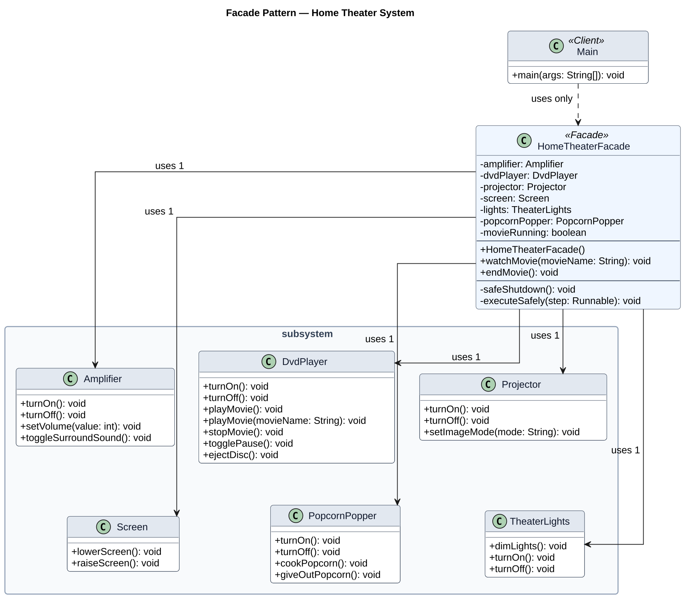

# Home Theater Facade

A Java implementation of the **Facade** design pattern for a home theater system.
`HomeTheaterFacade` provides a small API (`watchMovie` and `endMovie`) and coordinates six independent subsystem classes.

## Project structure

```
src/
  main/java/        application source code
  test/java/        JUnit tests
docs/UML.svg        UML class diagram
pom.xml             Maven configuration and JUnit dependency
```



## Run in IntelliJ IDEA

1. Clone the repository and open the project folder, or open `pom.xml`.
2. Select JDK 17 or newer when IntelliJ asks.
3. Run `Main` or run all tests from the Maven/Test panel.

## Run in VS Code

1. Install **Extension Pack for Java**.
2. Open the repository root folder.
3. Run `Main.java` using the **Run** button, or run tests from the Testing panel.

## Run from the terminal

With Maven installed:

```bash
mvn test
mvn package
java -cp target/classes Main
```

## Clean Code highlights

- Clear names such as `dimLights`, `toggleSurroundSound`, and `safeShutdown`.
- The facade coordinates workflow; subsystem classes keep device-specific behavior.
- Input validation rejects null or blank movie names.
- Safe shutdown attempts every cleanup step even if one device fails.
- The client depends on the facade rather than individual devices.
